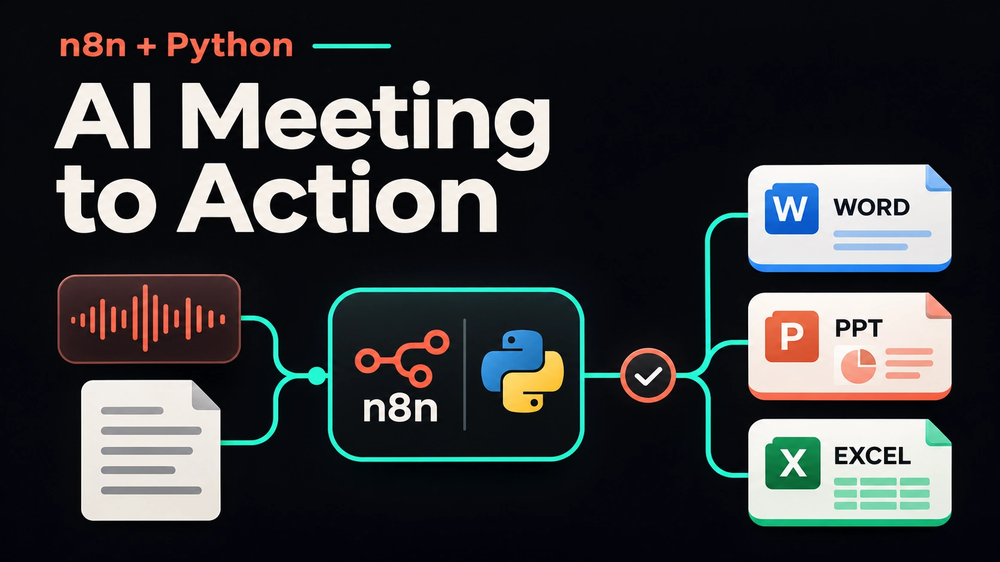
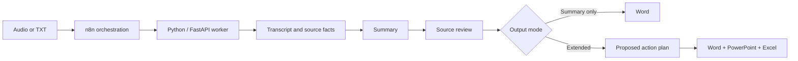

# AI Meeting-to-Action



A local Python and n8n workflow that turns meeting recordings or transcripts into **source-linked Word summaries, editable PowerPoint presentations, and Excel action plans**.

[Try the interactive demo](https://briannaufal211.github.io/personal-portfolio/demo.html) · [Watch the narrated n8n walkthrough](https://briannaufal211.github.io/personal-portfolio/watch-demo.html) · [Read the case study](https://briannaufal211.github.io/personal-portfolio/ai-meeting-to-action.html)

The public browser demo is a simulation using synthetic data. This repository contains the local application and orchestration source. Actual AI processing requires your own API credentials, configured models, internet access, and API billing.

## Problem and approach

Meeting follow-up often involves replaying recordings, writing summaries, preparing slides, and collecting tasks in separate documents. This project connects those stages while retaining transcript evidence and making uncertainty visible.

The workflow separates **recorded decisions** from **AI recommendations**. Missing owners, unconfirmed dates, and review findings remain visible instead of being presented as approved commitments.



## Features

- Audio or UTF-8 TXT input; TXT bypasses speech recognition.
- Summary-only and extended output modes; automatic or selected slide count.
- Source fact IDs and transcript quotations for review.
- Checkpoints, cached AI responses, single-worker queue, and resumable stages.
- n8n workflows for the local application, Docker-hosted n8n, and an n8n form.
- Review statuses such as `needs_review`; a completed workflow is not proof that its content is correct.
- Configurable paid-call limits and no automatic connection retries. These are safeguards, not guarantees of a fixed bill.

## Public edition

The public edition preserves the application and workflow logic, with two portability changes:

1. Word and PowerPoint use neutral editable layouts. Personal Canva/reference templates and photography are not included.
2. Excel is exported using **openpyxl**, replacing the private desktop artifact runtime. The workbook includes Ringkasan, Rekomendasi, Action Plan, Timeline, and Asumsi sheets. Excel or a compatible spreadsheet app calculates formulas when opening the file.

The portfolio video and earlier exported documents may use the original private design. See [architecture and privacy](docs/ARCHITECTURE.md) and [validation](docs/VALIDATION.md).

## Quick start — Windows

Requirements: Python **3.12**, Node.js with npm, and your own OpenAI API access for AI stages. GPU acceleration is optional. The application binds to loopback and is intended for a single trusted local user.

```powershell
git clone https://github.com/briannaufal211/AI-Meeting-to-Action.git
cd AI-Meeting-to-Action
python -m venv .venv
.\.venv\Scripts\Activate.ps1
python -m pip install -r requirements.txt
npm ci --ignore-scripts
Copy-Item .env.example .env
```

Edit `.env` locally: set `OPENAI_API_KEY`, `OPENAI_MODEL`, and `TRANSCRIPTION_MODEL` to credentials and model IDs available to your account. Never commit `.env`. The example cost rates are configuration examples, not current vendor prices; update them before relying on estimates.

```powershell
python run.py
```

Open **http://127.0.0.1:8765**. With no n8n service running, uncheck **Gunakan n8n lokal** and use the worker directly. Prefer the synthetic TXT in `examples/meeting-demo/transcript.txt` for an initial trial. Processing TXT through AI still uses paid API requests.

Linux/macOS: activate `.venv/bin/activate`, then use the same pip/npm commands and `python run.py`. Windows launch scripts are optional conveniences; GPU setup and native n8n scripts are Windows-specific. Cross-platform execution is covered by CI where noted, not by a production SLA.

## n8n setup

Follow [docs/N8N.md](docs/N8N.md). Import `n8n-workflow.json` for native local n8n, or `n8n-workflow-docker.json` when n8n runs in Docker. Configure the worker reachability before activating a workflow. The exported workflows contain no saved credentials or execution data.

## Reproduce document exports without API calls

The saved synthetic example can be rendered offline after installing the dependencies:

```powershell
python export_example.py
```

Files are written to `data/example-export/`, which is gitignored. This operation reads saved reports and facts; it does **not** transcribe audio, generate fresh AI analysis, or claim that the last AI plan audit passed.

## Tests

```powershell
python -m pytest -q
```

Tests use synthetic inputs and mocked AI responses. They verify contracts, source references, review behavior, cost controls, checkpoint reuse, output modes, local document exports, and upload protections. They do not establish speech-recognition accuracy or production performance.

## Repository map

| Path | Purpose |
| --- | --- |
| `app.py`, `index.html`, `run.py` | Local API, upload page, and launcher |
| `pipeline.py`, `schemas.py` | Processing stages and structured AI outputs |
| `summary_quality.py`, `quote_grounding.py` | Transcript evidence and review checks |
| `planning.py`, `planning_schemas.py` | Proposed recommendations and dependency validation |
| `reference_word.py`, `slide-layouts.cjs`, `excel_export.py` | Public document exporters |
| `n8n-*workflow*.json` | Importable n8n orchestration workflows |
| `examples/` | Clearly synthetic fixtures; no private recordings |
| `docs/` | Setup, privacy, architecture, and validation notes |

## Limits and data handling

Audio transcription and AI analysis can send audio/text to the configured API provider. The worker and saved jobs run locally; this is not a fully offline AI system. Do not process confidential recordings without the appropriate authorization. AI outputs can contain errors, and recommendations require human review and approval.

The local token and loopback binding do not replace production authentication, TLS, authorization, retention policies, or multi-tenant isolation. Do not expose the worker directly to the public internet. No recordings, API keys, `.env`, job caches, n8n databases, or private templates are included in this repository.

**Author:** Brian Naufal · [Portfolio](https://briannaufal211.github.io/personal-portfolio/)

No open-source license has been selected for the original project source. Third-party dependencies retain their respective licenses.
